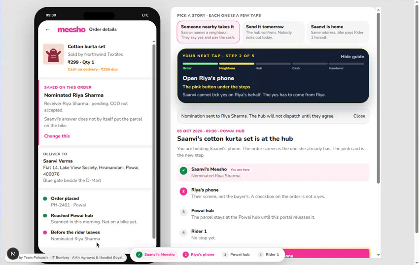

<h1 align="center">Pahunch</h1>

<p align="center"><b>Before the rider leaves the hub, ask the buyer one question. Then let a neighbour say yes on their own phone.</b><br>
A new step on top of a Meesho cash-on-delivery order, built for Valmo. Meesho DICE Challenge 3.0.</p>

<p align="center">
  <a href="https://pahunch-gamma.vercel.app">
    
  </a>
</p>

<h3 align="center">👉 <a href="https://pahunch-gamma.vercel.app">pahunch-gamma.vercel.app</a> 👈</h3>

<p align="center"><sub>No login. 5 taps. Works on phone and laptop. A yellow <b>Tap here</b> bubble shows you every click.</sub></p>

<p align="center">
  <a href="https://pahunch-gamma.vercel.app?order=PH-2401&play=neighbour"></a>
  <a href="https://pahunch-gamma.vercel.app?order=PH-2401&play=tomorrow"></a>
  <a href="https://pahunch-gamma.vercel.app?order=PH-2401&play=home"></a>
</p>

<p align="center">
  <a href="https://pahunch-gamma.vercel.app"></a>
</p>

<p align="center"><b>Team Pahunch · IIT Bombay · Arth Agrawal &amp; Nandini Goyal</b></p>

<p align="center">
  <a href="https://vercel.com/new"></a>
  &nbsp;
  <a href="https://render.com/deploy"></a>
  &nbsp;
  <a href="https://railway.com/new"></a>
</p>

---

## What you are looking at

Pahunch is a working prototype for the Meesho DICE Challenge 3.0, Round 2. When a cash-on-delivery parcel is at the local hub, it asks whether the buyer is ready, can connect that buyer to a named neighbour who agrees independently, and gives the hub and rider one current, payment-safe instruction.

It is a proposal for Valmo by Arth Agrawal and Nandini Goyal, IIT Bombay. It is not an official Meesho product.

The submitted presentation was not in this workspace. Economics and pilot design follow the implementation brief, which carries the case arithmetic.

## Run it

Requirements: Node.js 22 and npm.

```bash
npm install
npm run setup
npm run dev
```

Open [http://127.0.0.1:47231](http://127.0.0.1:47231).

`npm run setup` creates `data/pahunch.sqlite` and seeds the fictional orders (Saanvi in Powai, Kabir in Thane, Meera in Powai, plus three hub-only rows) if the file is missing. `npm run dev` does that setup and then starts Next.js on port 47231. `npm run reset` deletes and reseeds only that database.

```bash
npm test
```

## Put it on your GitHub in one go

From a machine with this folder:

```bash
./scripts/publish-github.sh            # creates github.com/<you>/pahunch and pushes (needs GitHub CLI)
./scripts/publish-github.sh https://github.com/<you>/<empty-repo>.git   # or push to a repo you made
```

Then connect that repo at [vercel.com/new](https://vercel.com/new) so every push redeploys the live MVP.

## Deploy it

The repo ships ready-made configs for three hosts. Pick one, connect this GitHub repo, and the defaults do the rest.

| Host | Config in repo | Demo state | Notes |
| --- | --- | --- | --- |
| **Render** (recommended) | `render.yaml` | Persistent (1 GB disk) | New → Blueprint → pick the repo. Disk needs the Starter plan. |
| **Railway** | `railway.json` | Persistent if you add a Volume | Add a volume mounted at `/data` and set `PAHUNCH_DB=/data/pahunch.sqlite`. |
| **Vercel** (live MVP) | none needed | Resets on cold start | Zero config, free, Node 22 preset. The SQLite file lives in `/tmp`, so the demo reseeds itself after idle periods. Fine for judges clicking through in one sitting; not for data you want to keep. |

Manual (any Node 22 host):

```bash
npm install
npm run build
npm run setup
npm start        # honours $PORT, defaults to 47231
```

Set `PAHUNCH_DB=/path/on/persistent/disk/pahunch.sqlite` if the host mounts storage somewhere specific. Everyone who opens the deployed link shares one database; the **Restart from the beginning** button on the right panel resets it.

The live MVP is on Vercel at https://pahunch-gamma.vercel.app. If you redeploy elsewhere, update the links at the top of this file.

## Calculations

Default case, held in `lib/domain/economics.ts` and covered by tests:

```text
COD RTO       = 80,000 × 20% = 16,000
Prepaid RTO   = 20,000 × 5%  = 1,000
Total RTO     = 17,000 / 1,00,000 = 17.0%
Target RTO    = 17.0% − 1.2 percentage points = 15.8%
Additional final RTOs prevented = 1,200
Gross avoided reverse cost = 1,200 × ₹120 = ₹1,44,000
Programme budget = ₹1,00,000
Modelled net = ₹44,000
Break-even = ceil(₹1,00,000 / ₹120) = 834
```

Reference nets at a ₹1,00,000 budget and ₹120 reverse cost: 600 gives −₹28,000, 834 gives ₹80, 1,200 gives ₹44,000. The ₹50 forward node cost, including ₹21 LMDC, is not added on top of the ₹120 reverse cost.

## Demo

The short path is in the in-app guide and in [docs/DEMO_SCRIPT.md](docs/DEMO_SCRIPT.md). The main order is PH-2401. Riya’s demo receipt code is 4821. Dev’s code, for the cancellation case, is 8086.

## Tests

`npm test` runs Vitest against the domain calculator, the SQLite service (including direct stale-task rejection) and the HTTP action route. The browser walkthrough is a separate check of the rendered hub, customer, neighbour and rider screens.

## Layout

- `lib/domain` — typed rules, metrics and the calculator
- `lib/server/service.ts` — transactions and audit events
- `lib/db` — SQLite schema and fictional seed
- `app/api` — state, actions and audit export
- `components` — hub, customer, neighbour, rider and pilot views
