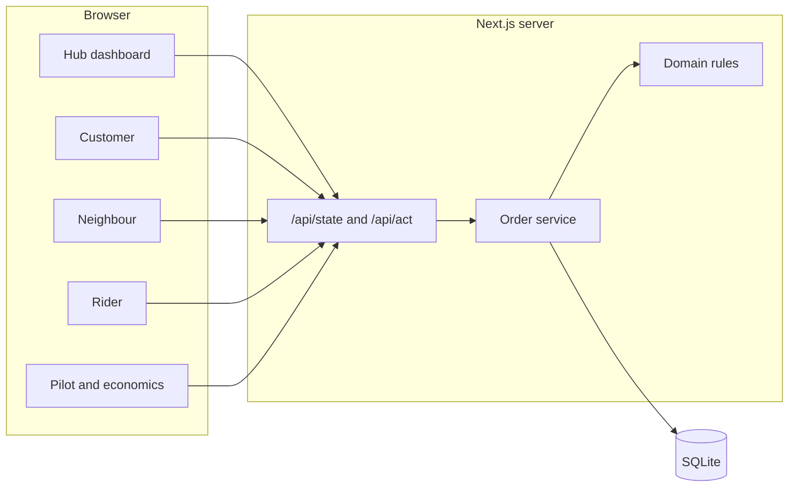

# Pahunch architecture

The browser never decides whether a handover is allowed. Each button calls `/api/act`. The service loads the current rows inside a SQLite transaction, and the domain module evaluates readiness, consent, payment, route caps and task version. The same functions are imported by the tests.

## Records

A shipment is not one status string. Readiness responses, nominations, payments, dispatch tasks, receipts, exceptions and audit events are separate tables. Superseded tasks stay in the audit trail with `invalidated` on the issue event.

COD due is the order amount minus confirmed or collected payments. A receipt row is unique per shipment, so a repeated handover cannot create a second delivery.

## Demo clock

"Today" comes from the `demo_now` setting, displayed in IST. Later-run dispatch stays closed until that date is due, or until the labelled advance-clock control moves the demo forward.
